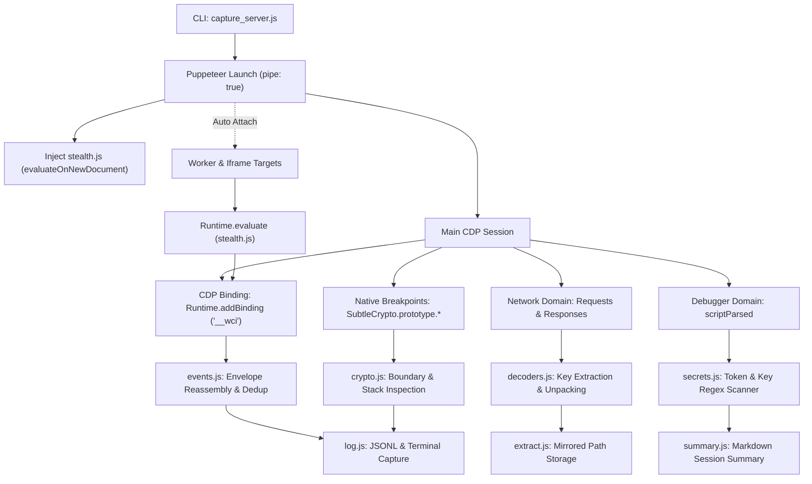

<div align="center">

# WebCrypto Interceptor

<p><strong>Chrome DevTools Protocol instrumentation toolkit for authorized WebCrypto observation, network analysis, and browser security research.</strong></p>

[](https://github.com/cipherwire/webcrypto-interceptor/actions/workflows/ci.yml)
[](https://nodejs.org/)
[](LICENSE)

<p>
WebCrypto Interceptor combines native Chrome DevTools Protocol (CDP) debugging capabilities with scope-agnostic in-page hooks to inspect browser cryptographic operations, network traffic, worker communications, WebAssembly binaries, and embedded secrets in real time.
</p>

<p>
  <a href="#project-overview">Overview</a> &bull;
  <a href="#features">Features</a> &bull;
  <a href="#requirements-and-compatibility">Requirements</a> &bull;
  <a href="#installation">Installation</a> &bull;
  <a href="#quick-start">Quick Start</a> &bull;
  <a href="#cli-options-and-usage">Usage</a> &bull;
  <a href="#offline-analysis">Offline Analysis</a> &bull;
  <a href="#architecture">Architecture</a> &bull;
  <a href="#development-and-testing">Testing</a> &bull;
  <a href="#responsible-use">Responsible Use</a>
</p>

</div>

---

## Project Overview

Web applications frequently rely on the W3C Web Cryptography API (`window.crypto.subtle`) to encrypt media streams, sign authentication tokens, and obscure client-server communication. Analyzing these routines using traditional proxy tools is often insufficient because payloads are encrypted before transmission and decrypted after receipt.

`webcrypto-interceptor` attaches directly to the Chromium browser engine via the Chrome DevTools Protocol. It operates over standard input/output pipes (`pipe: true`) rather than exposed WebSocket ports, avoiding open network listeners on the host.

The toolkit uses non-intrusive V8 debugger breakpoints (`Debugger.setBreakpointOnFunctionCall`) alongside page hooks communicating through a dedicated CDP binding channel (`Runtime.addBinding`). This architecture observes inputs, outputs, and call stacks across browser tabs, iframes, and Web Workers without modifying native function source strings.

This tool is designed specifically for authorized security research, protocol debugging, interoperability testing, and reverse engineering of software you own or have explicit permission to audit.

---

## Contents

- [Project Overview](#project-overview)
- [Features](#features)
- [Requirements and Compatibility](#requirements-and-compatibility)
- [Installation](#installation)
- [Quick Start](#quick-start)
- [CLI Options and Usage](#cli-options-and-usage)
- [Output Files and Workflows](#output-files-and-workflows)
- [Architecture](#architecture)
- [Offline Analysis](#offline-analysis)
- [Log Tags](#log-tags)
- [Development and Testing](#development-and-testing)
- [Limitations](#limitations)
- [Troubleshooting](#troubleshooting)
- [Responsible Use](#responsible-use)
- [Contributing and Support](#contributing-and-support)
- [License](#license)

---

## Features

### WebCrypto API Observation
- Monitors `crypto.subtle` operations including `encrypt`, `decrypt`, `sign`, `verify`, `digest`, `importKey`, `exportKey`, `deriveKey`, and `deriveBits`.
- Captures cleartext inputs, algorithm configurations, key attributes, and resulting ciphertext or plaintext.
- Records initiating JavaScript call stacks up to five frames deep for caller attribution.
- Samples `crypto.getRandomValues` invocations with rate-limiting to inspect initialization vectors and nonces.

### Network and Response Capture
- Observes outbound requests made via `fetch`, `XMLHttpRequest`, `sendBeacon`, and WebSocket connections.
- Automatically flags media manifest and segment URLs matching HLS and DASH formats (`.m3u8`, `.mpd`, `.ts`, `.m4s`).
- Extracts AES key patterns from response bodies, including JSON fields (`ck`, `key`, `contentKey`, `aesKey`), binary `application/octet-stream` payloads, and HLS `#EXT-X-KEY` declarations.
- Provides optional noise filtering to suppress third-party analytics and tracker requests.

### Multi-Target and Worker Instrumentation
- Automatically attaches to child targets, including iframes, Out-of-Process Iframes (OOPIFs), Dedicated Workers, Shared Workers, and Service Workers.
- Injects global scope hooks into workers via `Runtime.evaluate` to monitor background cryptographic operations.
- Intercepts `postMessage` traffic passing through `Worker` instances and `MessagePort` channels.

### Function Instrumentation and Return Value Capture
- Sets non-invasive breakpoints on arbitrary site functions using the `--hook` option without modifying `Function.prototype.toString`.
- Captures paired `(input, output)` execution tuples using the `--hook-return` option to support clean-room verification.

### WebAssembly and Asset Extraction
- Logs WebAssembly module compilation via `WebAssembly.instantiate` and `WebAssembly.compile`.
- Dumps compiled WebAssembly bytecode under 5 MB directly to disk.
- Automatically unpacks Dean Edwards packed JavaScript code and extracts embedded secrets.
- Full extraction mode (`--full`) mirrors downloaded HTML, scripts, sourcemaps, images, and rendered DOM to an organized local folder.

### Memory Diffing and Secret Scanning
- Compares V8 heap snapshots over a configurable interval (`--heap-diff`) to identify newly retained objects, strings, and typed arrays.
- Scans script sources via `Debugger.scriptParsed` for PEM certificates, DER keys, JSON Web Tokens (JWT), and hardcoded cryptographic constants.

---

## Requirements and Compatibility

### Runtime Requirements

- **Node.js**: Minimum declared version is `node: ">=22.12.0"` in `package.json` (aligned with `puppeteer` runtime requirements).
- **Browser Executable**: Requires a locally installed build of Google Chrome, Chromium, or Brave Browser. Alternatively, specify an explicit executable path using the `PUPPETEER_EXECUTABLE_PATH` environment variable.
- **Operating System**: Supported and tested on Windows, Linux, and macOS.

### Node.js Compatibility Matrix

| Node.js Version | Official Lifecycle Status (nodejs/Release) | Project Validation Status | Recommendation |
| :--- | :--- | :--- | :--- |
| **Node.js 22** | Maintenance LTS (Maintenance until April 30, 2027) | Declared minimum baseline (`>=22.12.0`). Configured in CI matrix. | Supported baseline for existing LTS deployments. |
| **Node.js 24** | Active LTS (Maintenance transition scheduled for October 20, 2026; EOL April 30, 2028) | Verified locally with passing unit and live browser E2E test suite. Configured in CI. | Recommended production LTS release. |
| **Node.js 26** | Current (Active LTS transition scheduled for October 28, 2026; EOL April 30, 2029) | Configured in CI test matrix. Forward compatibility target. | Supported for upcoming and forward-looking environments. |

> Note: Release schedule dates reflect the official Node.js release calendar (https://github.com/nodejs/Release). Scheduled maintenance and LTS transitions take effect according to upstream release availability.

---

## Installation

### 1. Clone the Repository

```bash
git clone https://github.com/cipherwire/webcrypto-interceptor.git
cd webcrypto-interceptor
```

### 2. Install Dependencies

Install the required production dependencies:

```bash
npm install
```

To skip the automated Chromium download when you plan to use an existing system Chrome or Brave installation:

**Windows (PowerShell):**
```powershell
$env:PUPPETEER_SKIP_DOWNLOAD = "true"
npm install
```

**Linux / macOS (Bash):**
```bash
PUPPETEER_SKIP_DOWNLOAD=true npm install
```

### 3. Verify Browser Detection

The toolkit automatically checks standard system install directories for Google Chrome and Brave. If your browser executable is stored in a non-standard location, set the environment variable:

**Windows (PowerShell):**
```powershell
$env:PUPPETEER_EXECUTABLE_PATH = "C:\Program Files\Google\Chrome\Application\chrome.exe"
```

**Linux / macOS (Bash):**
```bash
export PUPPETEER_EXECUTABLE_PATH="/usr/bin/google-chrome"
```

---

## Quick Start

Launch the interceptor against an authorized local or remote target:

```bash
node capture_server.js "http://127.0.0.1:8080/app" --gui
```

### What Happens at Startup:

1. Puppeteer launches the browser using stdio pipe transport (`pipe: true`).
2. Page-side stealth hooks (`src/page/stealth.js`) are registered to evaluate before document scripts.
3. Native breakpoints are attached to `window.crypto.subtle` methods.
4. An event channel binding (`__wci`) is established for structured event streaming.
5. All observed events are printed to the terminal and appended to `session_capture_<timestamp>.jsonl` in the current working directory.
6. Pressing `Ctrl+C` flushes pending disk writes, outputs a markdown summary report, and closes the browser session cleanly.

*Notice: Always ensure you have permission to monitor and intercept traffic on the target URL.*

---

## CLI Options and Usage

### Syntax

```bash
node capture_server.js <URL> [options]
```

### Options Reference

| Option | Type | Default | Description |
| :--- | :--- | :--- | :--- |
| `<URL>` | Positional | *(Required)* | Target URL starting with `http://` or `https://`. |
| `--gui` | Boolean | `false` | Launch browser in visible headful mode instead of headless. |
| `--brave` | Boolean | `false` | Select Brave Browser instead of Chrome or Chromium. |
| `--full` | Boolean | `false` | Enable full extraction mode (mirrors all responses to disk). |
| `--out <dir>` | String | `.` | Output directory for logs, summaries, and extracted assets. |
| `--timeout <sec>` | Integer | `60` | Page navigation timeout in seconds. |
| `--ua <string>` | String | `null` | Custom User-Agent string applied to all attached targets. |
| `--proxy <addr>` | String | `null` | Upstream proxy server (e.g. `http://127.0.0.1:8080` or `socks5://127.0.0.1:9050`). |
| `--all-traffic` | Boolean | `false` | Disable analytics and tracker noise filtering to capture all requests. |
| `--hook <expr>` | String | `[]` | Arm function call breakpoint. Repeatable option. |
| `--hook-return <expr>` | String | `[]` | Arm function call and return breakpoints for input/output logging. Repeatable. |
| `--trace-flow <expr>` | String | `[]` | Arm return breakpoint and trace downstream consumer variable and frame. Repeatable. |
| `--dump-strings <expr>` | String | `null` | Drive page's runtime string decoder across index ranges to dump rotated string tables. |
| `--trace-vm <loc>` | String | `[]` | Trace a bytecode VM dispatch loop at script location `<urlRegex:line[:column]>`. |
| `--watch <exprs>` | String | `null` | Comma-separated expressions to evaluate on VM loop hit (`pc,op,stack[sp]`). |
| `--heap-diff <sec>` | Integer | `0` | Capture two heap snapshots separated by N seconds to report retained allocations. |
| `--help` | Boolean | `false` | Display command help and exit. |

### Practical Usage Examples

#### Run in Headful GUI Mode with Brave Browser
```bash
node capture_server.js "https://target.local" --brave --gui
```

#### Full Asset Extraction with Custom Output Directory
```bash
node capture_server.js "https://target.local" --full --out ./captures --timeout 90
```

#### Route Traffic Through an Upstream Security Proxy
```bash
node capture_server.js "https://target.local" --proxy "http://127.0.0.1:8080" --gui
```

#### Hook a Function and Capture Return Values
```bash
node capture_server.js "https://target.local" --hook-return "window.signPayload"
```

#### Follow Forward Dataflow from Producer to Consumer
```bash
node capture_server.js "https://target.local" --trace-flow "window.signPayload"
```

#### Dump Runtime-Rotated Obfuscated Strings
```bash
node capture_server.js "https://target.local" --dump-strings "_0x1a2b"
```

#### Trace Bytecode VM Dispatch Loop
```bash
node capture_server.js "https://target.local" --trace-vm "engine.js:142" --watch "pc,opcode,stack[sp]"
```

#### Run Heap Allocation Diffing After Navigation
```bash
node capture_server.js "https://target.local" --heap-diff 15
```

---

## Output Files and Workflows

Running `webcrypto-interceptor` generates structured artifacts designed for both manual review and automated analysis:

```
<output-directory>/
├── session_capture_1730000000.jsonl          # Stream of all captured events
├── session_capture_1730000000_summary.md     # Markdown session metrics report
└── <hostname>_1730000000/                    # Created when using --full
    ├── terminal_output.txt                   # Plaintext terminal transcript
    ├── _rendered.html                        # Post-render snapshot of the DOM
    ├── extracted_summary.json                # JSON catalog of keys, secrets, and files
    ├── _sources/                             # Unpacked sourcemap files
    ├── wasm/                                 # Dumped WebAssembly binaries (< 5 MB)
    └── <path>/<file>                         # Mirrored network responses
```

### Sensitive Data Notice

Captured files frequently contain sensitive information, including cryptographic keys, plaintext payloads, authorization tokens, session cookies, and private request parameters. Store capture files securely, exclude them from public repositories, and sanitize data before sharing bug reports.

---

## Architecture

The diagram below illustrates how `webcrypto-interceptor` coordinates browser control, event interception, and output logging:



### Dual-Channel Event Transport

1. **Structured Binding Channel (`Runtime.addBinding`)**: The page-side script emits JSON envelopes directly to the host via `window.__wci()`. This transport bypasses console filtering, prevents string truncation, and operates inside Web Workers where `console.log` is not relayed by default. Large payloads such as WebAssembly bytecode are chunked into 200 KB segments and reassembled by `events.js`.
2. **Legacy Console Fallback**: If the binding fails to register or a context attaches mid-flight, hooks emit formatted `[Reversed-Event]` lines to `console.log`. Events are deduplicated by UID to ensure each event is recorded exactly once.

---

## Offline Analysis

### 1. Extract AES Keys and Generate OpenSSL Commands

The offline key extractor parses a session log, correlates `crypto.subtle.importKey` and `decrypt` calls with preceding media requests, and prints OpenSSL command templates:

```bash
node scripts/extract-keys.js session_capture_1730000000.jsonl
```

#### Example Output:
```text
url:  https://media.example.local/stream/segment_001.ts
algo: AES-CBC
key:  0123456789abcdef0123456789abcdef
iv:   fedcba9876543210fedcba9876543210
# openssl enc -d -aes-128-cbc -K 0123456789abcdef0123456789abcdef -iv fedcba9876543210fedcba9876543210 -in seg.enc -out seg.dec

1 key/iv pair(s) extracted from session_capture_1730000000.jsonl
```

### 2. Verify Candidate Reimplementations

When reverse engineering custom cryptographic routines or payload packers, capture ground-truth executions using `--hook-return`:

```bash
node capture_server.js "https://target.local" --hook-return "window.signPayload"
```

Then test your clean-room JavaScript reimplementation against the recorded dataset:

```bash
node scripts/verify-reimpl.js --session session_capture_1730000000.jsonl --candidate ./my_signer.js --label "window.signPayload"
```

The verifier executes your candidate function in an isolated headless browser page (`about:blank`) without network access, comparing return values against recorded ground truth using strict deep equality:

```text
Tested 25 recorded calls:
  matched: 25/25 (VERIFIED)
  mismatched: 0
```

---

## Log Tags

Terminal output uses structured tags to categorize observed events:

| Tag | Category | Description |
| :--- | :--- | :--- |
| `[🔓 CRYPTO BOUNDARY]` | WebCrypto | `crypto.subtle` operation invoked with caller stack trace. |
| `[🔓 CRYPTO ARGS]` | WebCrypto | Arguments passed to a subtle cryptographic method. |
| `[🔓 CRYPTO RESULT]` | WebCrypto | Value returned by an operation (key metadata, ciphertext, plaintext). |
| `[🎲 RANDOM]` | WebCrypto | `crypto.getRandomValues` invocation and returned buffer. |
| `[🌐 NET]` | Network | Outbound HTTP request initiated via fetch, XHR, or sendBeacon. |
| `[🌐 NET RESP]` | Network | Response body containing an authorization token or cryptographic key. |
| `[🔌 WS]` | Network | WebSocket frame sent or received. |
| `[🎬 VIDEO]` | Media | Media manifest or segment request (`.m3u8`, `.mpd`, `.ts`, `.m4s`). |
| `[🔑 CONTENT KEY]` | Keys | AES key extracted from a JSON field or HTTP header. |
| `[🔑 RAW AES KEY]` | Keys | Binary key detected in an octet-stream response. |
| `[🔐 HLS AES KEY URI]` | Keys | URI and IV extracted from an HLS `#EXT-X-KEY` directive. |
| `[🔑 SECRET]` | Scanner | Pattern match for PEM certificates, private keys, or JWT tokens. |
| `[📨 MSG]` | Workers | Message passed via `Worker.postMessage` or `MessagePort`. |
| `[🗂️ BLOB URL]` | Storage | Blob URL created via `URL.createObjectURL`. |
| `[📄 BLOB CONTENT]` | Storage | Text or script source code loaded into a Blob. |
| `[💾 STORAGE STATE]` | Storage | Sensitive item written to `localStorage` or `sessionStorage`. |
| `[🧬 WASM INJECT]` | WebAssembly | WebAssembly module compiled or instantiated. |
| `[🧬 WASM DUMPED]` | WebAssembly | WebAssembly binary bytecode saved to disk. |
| `[🕷️ CRYPTO HOOK]` | Debugger | Native V8 breakpoints armed on a target context. |
| `[🪝 HOOK]` | Hooks | Function hooked via `--hook` executed (arguments and stack logged). |
| `[🪝 HOOK PAIR]` | Hooks | Function hooked via `--hook-return` finished (input and output recorded). |
| `[🌊 DATAFLOW]` | Dataflow | Hooked function returned and linked downstream to caller and variable. |
| `[🪢 STRING UNPACKER]` | Deob | Runtime string decoder executed across index ranges to extract tables. |
| `[🧬 VM WATCH]` | VM | Bytecode interpreter dispatch loop hit with evaluated register states. |
| `[🧠 HEAP DIFF]` | Memory | Summary of heap allocations between snapshots. |

---

## Development and Testing

The repository uses Node's native test runner (`node:test`) and ESLint for code quality.

### Run the Test Suite

```bash
npm test
```

The test runner executes all unit tests and automatically detects whether a local browser binary is available:
- **Unit Tests (95 tests)**: Exercise pure logic modules (decoders, secret scanner, URL sanitization, CLI parsing, event deserialization, string table extraction, dataflow resolution, and VM state tracking) in approximately 250 milliseconds with zero external dependencies.
- **Browser E2E Test (`tests/e2e.test.js`)**: When Chrome or Brave is detected, launches headless Chrome, initializes a secure context, and confirms WebCrypto AES-GCM interception.

### Skip Browser E2E Tests

To run only unit tests without launching a browser:

**Windows (PowerShell):**
```powershell
$env:SKIP_E2E = "1"
npm test
```

**Linux / macOS (Bash):**
```bash
SKIP_E2E=1 npm test
```

### Run Static Analysis

Verify code style and formatting:

```bash
npm run lint
```

---

## Limitations

1. **Secure Context Requirement**: The W3C Web Cryptography API (`window.crypto.subtle`) is restricted by modern browsers to Secure Contexts (HTTPS, `http://localhost`, or `http://127.0.0.1`). Pages loaded over plain HTTP cannot execute WebCrypto operations.
2. **WebSocket Caller Stacks**: Native CDP WebSocket events capture frame payloads out-of-process, but do not provide the initiating JavaScript call stack. Page-side hooks provide call stacks but carry an in-page detection surface.
3. **WebAuthn Scope**: Chrome DevTools Protocol supports virtual software authenticators for automated testing, but cannot bypass cryptographic isolation or extract private keys from physical hardware security keys (e.g. YubiKeys or TPMs).
4. **WebAssembly Tracing**: The toolkit dumps `.wasm` bytecode and wraps exports at the JavaScript boundary. It does not perform dynamic instruction-level tracing inside compiled WebAssembly binary routines.
5. **Memory Snapshot Cost**: Heap snapshot diffing (`--heap-diff`) pauses V8 execution while traversing the object graph. On web applications with multi-gigabyte heap footprints, snapshot capture may introduce visible latency.

---

## Troubleshooting

### Browser Binary Not Found
**Symptom**: `Brave browser was not found at standard install locations` or `Chrome binary not found`.
**Resolution**: Set the `PUPPETEER_EXECUTABLE_PATH` environment variable pointing directly to your browser binary.

### Navigation Timeouts
**Symptom**: `Navigation issue (page may still be usable): Navigation timeout of 60000 ms exceeded`.
**Resolution**: Complex single-page applications or slow network connections may take longer than 60 seconds to reach an idle state. Increase the timeout with `--timeout 120`.

### Incomplete Crypto Logging on HTTP Targets
**Symptom**: The target page runs without errors, but no `[🔓 CRYPTO BOUNDARY]` events appear.
**Resolution**: Check whether the target page is served over plain HTTP. In Chromium browsers, `window.crypto.subtle` is `undefined` in non-secure origins.

---

## Responsible Use

Browser instrumentation and traffic interception tools provide deep visibility into client-side software execution. Operators must adhere to the following principles:

1. **Explicit Authorization**: Only use this software on applications, websites, and infrastructure you own or have received formal authorization to test.
2. **Data Protection**: Capture logs may contain real credentials, private personal information, and session tokens. Handle all output files with appropriate data governance.
3. **Legal Compliance**: You are solely responsible for ensuring your security research complies with local, state, national, and international laws, as well as applicable terms of service.

Refer to [`SECURITY.md`](SECURITY.md) for vulnerability disclosure procedures.

---

## Contributing and Support

- **Bug Reports**: Open an issue on the [GitHub Issues tracker](https://github.com/cipherwire/webcrypto-interceptor/issues).
- **Contributions**: Review the guidelines in [`CONTRIBUTING.md`](CONTRIBUTING.md) before submitting pull requests.
- **Security Inquiries**: Report security vulnerabilities privately following the instructions in [`SECURITY.md`](SECURITY.md).
- **Community**: Join technical discussions on [Discord](https://discord.gg/QphWRKHvH2).

---

## License

This project is licensed under the **MIT License** with an additional **Responsible Use Notice**. See the [`LICENSE`](LICENSE) file for the full text.
